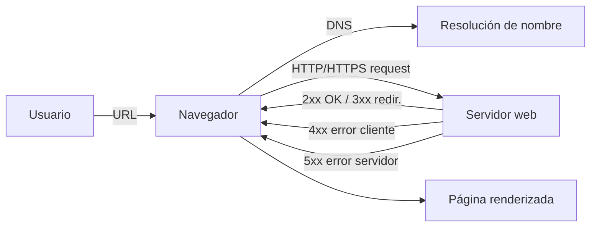

# Esquema: Flujo de petición/respuesta HTTP

## Notas clave
- **Códigos 4xx** indican error por parte del cliente (401 Unauthorized, 403 Forbidden, 404 Not Found, 405 Method Not Allowed).
- **401** requiere autenticación; **403** indica falta de autorización para el recurso.
- **503 Service Unavailable** indica servicio no disponible (error de servidor).
- Métodos **idempotentes pero no seguros**: PUT, DELETE. Idempotentes y seguros: GET, HEAD.
- **HTTP/2** es binario (identificadores h2 sobre TLS y h2c sobre TCP en claro); definido en RFC 7540.
