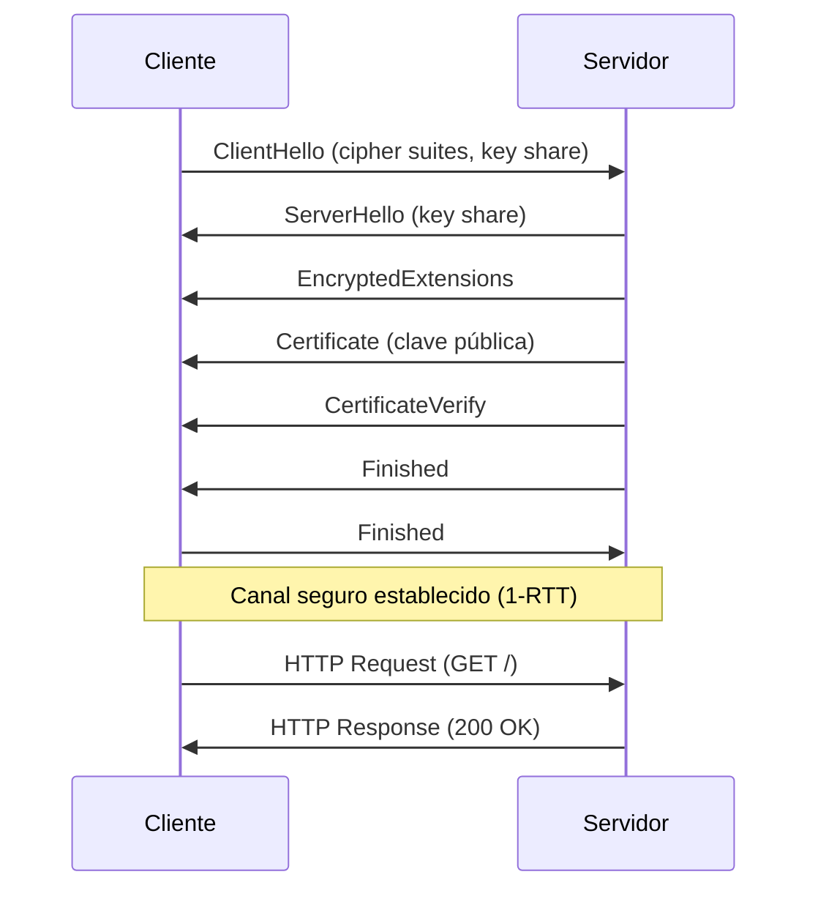

# Esquema: Handshake TLS 1.3 y conexión HTTPS

## Notas clave
- **TLS 1.3** negocia parámetros mediante **ClientHello, ServerHello, HelloRetryRequest** (entre otros); **HelloRequest no existe en TLS 1.3** (era de TLS 1.2).
- El navegador necesita la **clave pública del certificado del sitio** para establecer HTTPS; la clave privada permanece en el servidor.
- Ventaja principal frente a TLS 1.2: handshake en **un solo viaje de ida y vuelta (1-RTT)**, reduciendo latencia.
- Certificados digitales siguen siendo necesarios (no se eliminan en TLS 1.3).
