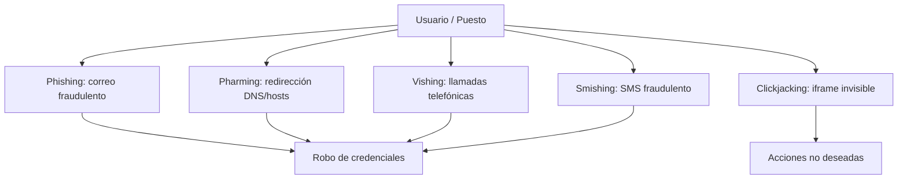

# Esquema: Amenazas al puesto del usuario



## Notas clave
- **Pharming** obtiene credenciales de forma ilícita redirigiendo el tráfico a un sitio falso (manipulación de DNS/hosts).
- **Vishing** suplanta a una entidad legítima mediante llamadas telefónicas.
- **Clickjacking** superpone un iframe invisible para capturar clics del usuario.
- **MFA** y **formación** son medidas clave de mitigación.
- **Cookies seguras** (HttpOnly, Secure, SameSite) protegen la sesión frente a XSS/CSRF.
```
