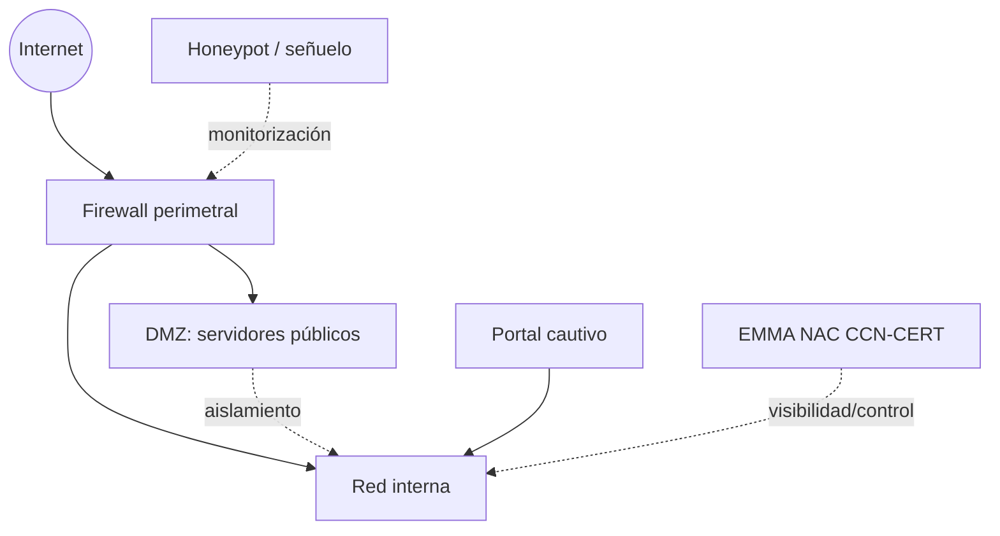

# Esquema: Arquitectura de seguridad perimetral



## Notas clave
- **DMZ** aísla los servidores que ofrecen servicios al exterior, impidiendo que una intrusión en ellos comprometa la red interna.
- **Firewall** filtra tráfico entre zonas de seguridad (Internet, DMZ, red interna).
- **Honeypot** actúa como señuelo para atraer atacantes y estudiar sus técnicas.
- **Portal cautivo** exige autenticación/aceptación antes de conceder acceso a la red.
- **EMMA** (CCN-CERT) proporciona visibilidad y control sobre la red (NAC).
- **MACsec (IEEE 802.1AE)** protege datos en la capa de enlace Ethernet.
```
