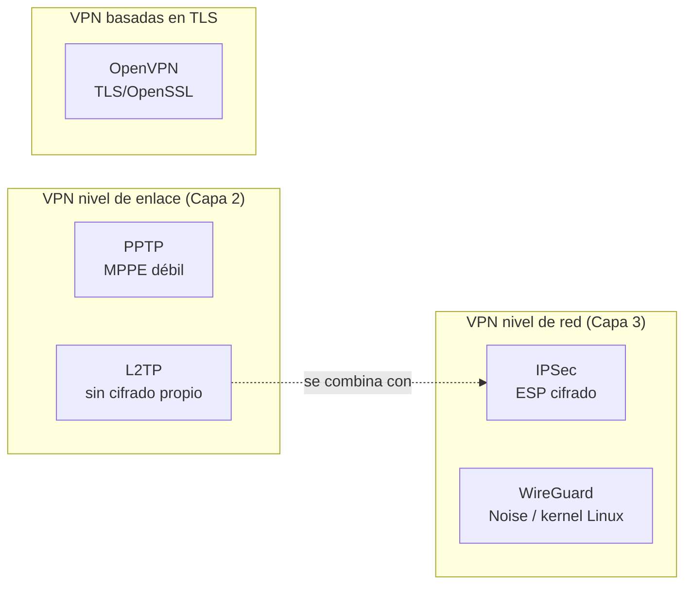

# Esquema: Protocolos VPN por capa y cifrado



## Notas clave
- **IPSec** opera en capa de red (nivel 3) y proporciona cifrado (ESP) y autenticación (IKE).
- **WireGuard** también opera en capa de red y se implementa como interfaz virtual en el kernel de Linux.
- **PPTP** (capa 2) usa MPPE y se considera obsoleto/inseguro.
- **L2TP** (capa 2) no cifra por sí solo; se combina con IPSec.
- **OpenVPN** usa TLS/OpenSSL y puede funcionar sobre UDP o TCP.
- VPN de nivel de enlace: protocolos como PPTP, L2TP, PPP; IPSec no es de nivel de enlace.
```
