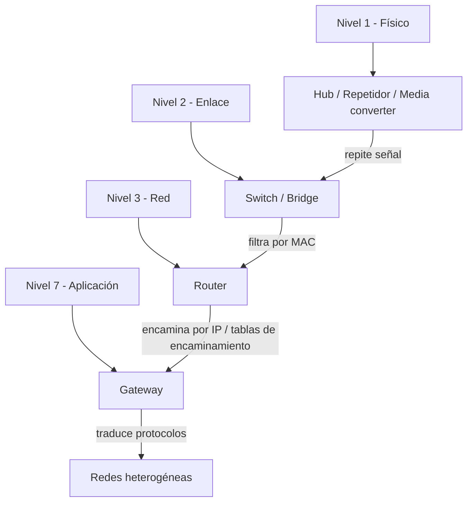

# Esquema: Dispositivos de interconexión por nivel OSI

## Notas clave
- **Hub**: nivel 1, repite la señal a todos los puertos; dominio de colisión compartido.
- **Switch/Bridge**: nivel 2, filtran/conmutan por dirección MAC.
- **Router**: nivel 3, utiliza tablas de encaminamiento para interconectar redes.
- **Gateway**: traduce protocolos entre redes distintas (ej. coaxial a Ethernet).
- **Repetidor/Media converter**: nivel 1, regeneran señal o convierten medios.
