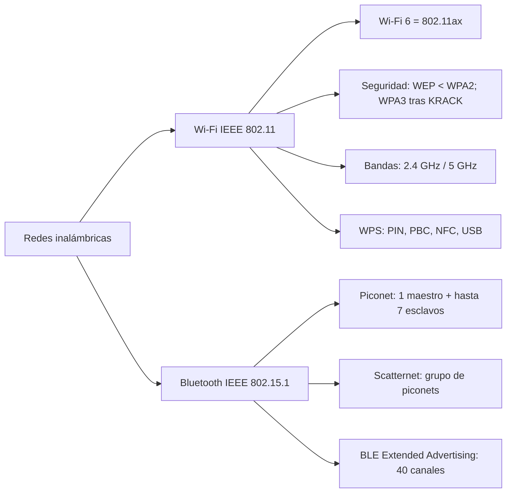

# Esquema: Redes inalámbricas y estándares

## Notas clave
- **Wi-Fi 6** se corresponde con **IEEE 802.11ax**.
- **WEP** es inferior a **WPA2**; **WPA3** mejora WPA2-PSK (AES) tras el ataque KRACK.
- **2,4 GHz** tiene mayor alcance e interferencias (Bluetooth); **5 GHz** menor alcance.
- **WPS** admite PIN, PBC, NFC y USB.
- **Bluetooth**: piconet y scatternet; BLE Extended Advertising usa 40 canales.
- **SOHO**: Small Office, Home Office.
