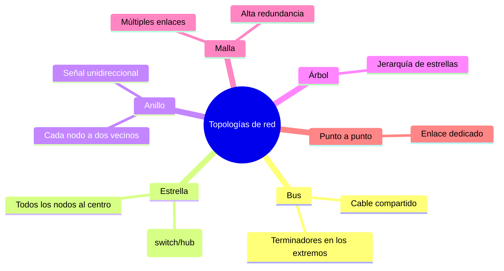

# Esquema: Topologías de red

## Notas clave
- **Bus**: terminadores absorben la señal y evitan reflexiones.
- **Estrella**: todos los nodos conectados a un nodo central.
- **Anillo**: cada nodo conectado a dos vecinos formando un anillo.
- **Árbol**: combinación jerárquica de estrellas.
- **Malla**: alta redundancia y tolerancia a fallos.
